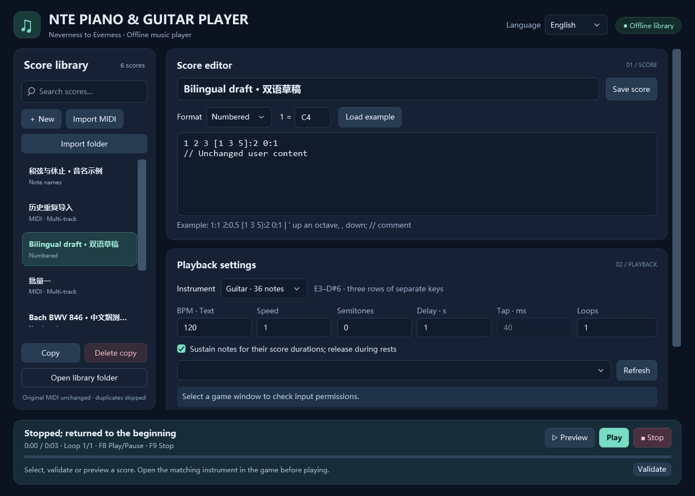

# NTE Piano & Guitar Player for Neverness to Everness

[English](README.en.md) | [简体中文](README.md)

[](https://github.com/Diana6324/NTE-Piano-Guitar-Player/actions/workflows/ci.yml)
[](LICENSE)

**NTE Piano & Guitar Player** (异环钢琴吉他演奏工具, formerly Guitar NTE) is an offline Windows desktop tool for playing MIDI, numbered notation and note-name scores with 36-note piano or guitar keyboard layouts in **Neverness to Everness (NTE / 异环)**. Built with WPF and .NET 10, with live **English / Simplified Chinese** switching.



## Download and play

1. Download `NTE-Piano-Guitar-Player-win-x64.zip` from [Releases](https://github.com/Diana6324/NTE-Piano-Guitar-Player/releases/latest).
2. Extract the entire archive and run `GuitarNTE.exe` on Windows 10 / 11 x64. The portable package includes .NET; no separate runtime installation is needed.
3. Choose **English** in the language selector at the top right. Changes apply immediately and are remembered after restarting. On first use, Chinese Windows uses Chinese; other Windows UI languages use English.
4. Match the instrument and key bindings in the app and game. Import a MIDI file / folder or enter a text score.
5. Click **Validate**, try **Preview**, select the game window, then click **Play** and switch back before the countdown ends.

Default shortcuts: **F8** starts / pauses / resumes; **F9** stops immediately. Preview sends no keyboard input and produces no local audio.

The package is unsigned. Use the accompanying `SHA256SUMS.txt` release attachment to verify the ZIP and EXE. Game acceptance of simulated input requires testing in your target environment.

## Features

- Guitar **E3–D#6** and piano **C3–B5**, 36 notes each, with separate saved key maps and Shift / Ctrl piano semitones.
- Single-file or recursive folder MIDI import, multi-track selection and original tempo changes; percussion excluded by default.
- SHA-256 content-based MIDI duplicate detection, with recoverable backups of identical historical library entries.
- Instant title search, multiple AND terms, `Ctrl+F` and `Esc`.
- Numbered notation, note names, chords, rests, transpose, speed, loops, sustained notes and fixed-duration key taps.
- Countdown, global hotkeys, focus-loss pause, permission preflight and key release on stop or failure.
- Live bilingual labels, hints, playback messages, validation errors and app-owned file-dialog titles.
- Offline library at `%LocalAppData%\GuitarNTE`; source MIDI files are never modified during import.

See the [English user guide](docs/USER_GUIDE.en.md) for notation, key maps, MIDI behavior and troubleshooting. Language switching preserves unsaved score text and pending key edits; it is disabled during playback and folder import. Existing score titles, comments, file paths and MIDI track names retain their original content. Windows-owned dialog buttons and system error details follow Windows language settings.

## Build from source

Requires Windows 10 / 11 x64, Git and the [.NET 10 SDK](https://dotnet.microsoft.com/download/dotnet/10.0). The first dependency restore needs internet access; the app itself runs offline. WPF does not run on Linux or macOS.

```powershell
git clone https://github.com/Diana6324/NTE-Piano-Guitar-Player.git
cd NTE-Piano-Guitar-Player
dotnet restore GuitarNTE.slnx --locked-mode
dotnet build GuitarNTE.slnx -c Release --no-restore
dotnet run --project src/GuitarNTE.App -c Release --no-build
```

```powershell
dotnet run --project tests/GuitarNTE.Tests -c Release --no-build
dotnet run --project tests/GuitarNTE.Tests -c Release --no-build -- --ui-headless
./build.ps1
```

The tests are an executable assertion suite, not a `dotnet test` project. Nonzero exit codes indicate failure. Packaging produces a self-contained Windows x64 ZIP and `SHA256SUMS.txt` under `artifacts/`. Use an empty output directory or a new `-OutputName` to prevent stale files from entering a release.

Read the [development guide](docs/DEVELOPMENT.en.md) for architecture, localization, tests and releases, and [validation notes](VALIDATION.md) for recorded checks and their limits.

## Data compatibility and scope

The executable name `GuitarNTE.exe`, internal project identifiers, `%LocalAppData%\GuitarNTE` and `GUITAR_NTE_DATA` remain compatible with previous versions. Renaming does not move, reset or translate your library or custom key maps.

Keyboard playback does not reproduce MIDI velocity, pedal timbre or recordings. Out-of-range notes are folded by octaves and may change the original voicing. The app does not modify the game process or files and provides no anti-cheat bypass. Follow the target software's rules. This is an independent community tool, not an official game product.

Source and release packages exclude personal MIDI collections, imported libraries, audio / video, recognition caches and Python environments. Optional Python score-preparation scripts are separate from desktop runtime functionality.

## Contribute and license

Use [Issues](https://github.com/Diana6324/NTE-Piano-Guitar-Player/issues) for reproducible problems and feature suggestions. Read [contribution guidelines](CONTRIBUTING.en.md) and the [security policy](SECURITY.en.md) before submitting changes or sensitive reports.

Original code and documentation use the [MIT License](LICENSE). Dependencies retain their own licenses; see [third-party notices](THIRD-PARTY-NOTICES.md). The software license does not grant rights to imported music, recordings or game content.
