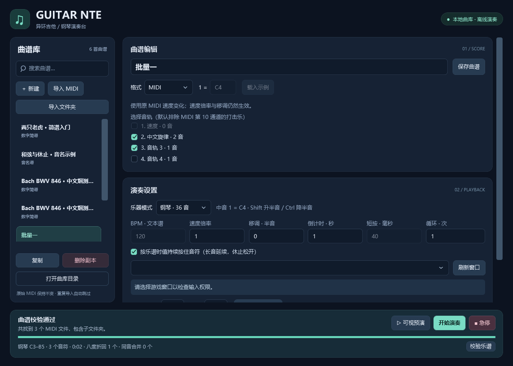

# Guitar NTE · 异环吉他 / 钢琴演奏工具

[](https://github.com/Diana6324/GuitarNTE/actions/workflows/ci.yml)
[](LICENSE)

面向 Windows 的中文桌面演奏工具，使用 WPF / .NET 10 开发。将 MIDI、数字简谱或音名谱映射为吉他 / 钢琴的 36 音键位，通过 Windows 键盘输入发送到所选窗口。应用运行时完全离线。



## 下载与开始使用

1. 打开 [Releases](https://github.com/Diana6324/GuitarNTE/releases/latest)，下载 `GuitarNTE-win-x64.zip`。
2. 完整解压，在 Windows 10 / 11 x64 上运行 `GuitarNTE.exe`。发布包自带 .NET，无需另外安装运行时。
3. 在工具与游戏中选择相同乐器和键位；导入 MIDI 或从 `examples` 复制文本谱。
4. 点击「校验乐谱」，先用「可视预演」核对，再选择目标窗口并开始。
5. 默认 **F8 开始 / 暂停 / 继续，F9 急停**；倒计时结束前切回目标窗口。

发布包未进行代码签名。可用随附的 `SHA256SUMS.txt` 核对下载完整性。实际游戏对系统模拟输入的接收情况仍需自行验证。

## 功能

- 吉他 E3–D♯6、钢琴 C3–B5，分别保存自定义键位，钢琴支持 Shift / Ctrl 半音组合。
- 导入单个 MIDI 或递归导入文件夹，选择多个音轨，保留速度变化，默认排除打击乐。
- 按 MIDI 原始字节的 SHA-256 去重；历史完全重复项目先备份再整理，保留不同演奏参数的版本。
- 中文 / 英文即时曲谱搜索，支持多个关键词、`Ctrl+F` 聚焦与 `Esc` 清空。
- 数字简谱、音名谱、和弦、休止、移调、速度倍率、循环、按时值持续按键或固定短按。
- 倒计时、全局热键、失焦暂停、输入权限检查、异常释放按键、无输入的可视预演。
- 曲库与设置保存在 `%LocalAppData%\GuitarNTE`，导入时不修改原文件。

完整操作、谱面语法、键位表与故障排查见 [使用指南](docs/USER_GUIDE.md)。

## 从源码运行

需要 Windows 10 / 11 x64、Git 和 [.NET 10 SDK](https://dotnet.microsoft.com/download/dotnet/10.0)。首次还原依赖需要联网；WPF 不支持在 Linux / macOS 上运行。

```powershell
git clone https://github.com/Diana6324/GuitarNTE.git
cd GuitarNTE
dotnet restore GuitarNTE.slnx --locked-mode
dotnet build GuitarNTE.slnx -c Release --no-restore
dotnet run --project src/GuitarNTE.App -c Release --no-build
```

```powershell
# 可执行断言集；非零退出码表示失败，不使用 dotnet test
dotnet run --project tests/GuitarNTE.Tests -c Release --no-build
# 使用隔离曲库，在内存中验证 WPF 流程并输出截图
dotnet run --project tests/GuitarNTE.Tests -c Release --no-build -- --ui-headless
# 生成自带运行时的 Windows x64 ZIP 和 SHA-256 校验文件
./build.ps1
```

构建结果位于 `artifacts/GuitarNTE-win-x64/` 与 `artifacts/GuitarNTE-win-x64.zip`。开发、测试及发布步骤见 [开发指南](docs/DEVELOPMENT.md)，本次验证与适用边界见 [VALIDATION.md](VALIDATION.md)。

## 项目结构

```text
src/GuitarNTE.Core/     曲谱解析、MIDI、音高映射、按键计划与调度
src/GuitarNTE.App/      WPF 界面、曲库、窗口选择与 Windows 输入
tests/GuitarNTE.Tests/  自动断言集、WPF 冒烟与可选本机输入验证
examples/              文本谱及 36 音试音示例
tools/                 可选 Python 转谱与参考试听脚本
docs/                  使用、开发及发布说明
.github/               CI、依赖更新及反馈模板
```

## 数据与适用范围

程序不修改目标进程或游戏文件，不提供反作弊绕过。失焦会暂停；Windows 权限隔离可能阻止输入，详情见使用指南。键盘演奏不能还原 MIDI 力度、踏板音色或原录音；超出音域的音按八度折回，可能改变声部关系。可视预演不播放音频。请遵守目标软件的使用规则。

公开仓库和发布包仅包含程序、文档与文本示例。本地 `midi/`、`songs/`、用户曲库、音视频、识别缓存及历史构建产物不上传。Python 辅助脚本不属于桌面应用运行依赖，使用方法见开发指南。

## 贡献与许可

欢迎通过 [Issues](https://github.com/Diana6324/GuitarNTE/issues) 反馈问题或建议，提交代码前请阅读 [贡献指南](CONTRIBUTING.md) 和 [行为准则](CODE_OF_CONDUCT.md)。安全问题请按 [SECURITY.md](SECURITY.md) 私下报告。

项目原创代码与文档采用 [MIT License](LICENSE)。第三方组件保留各自许可，见 [THIRD-PARTY-NOTICES.md](THIRD-PARTY-NOTICES.md)。软件许可不授予任何导入曲谱、录音或游戏内容的版权许可。
